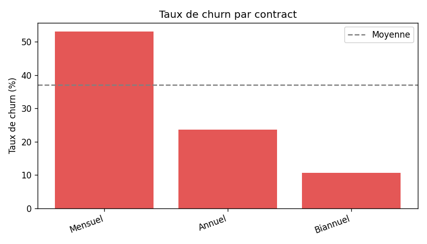
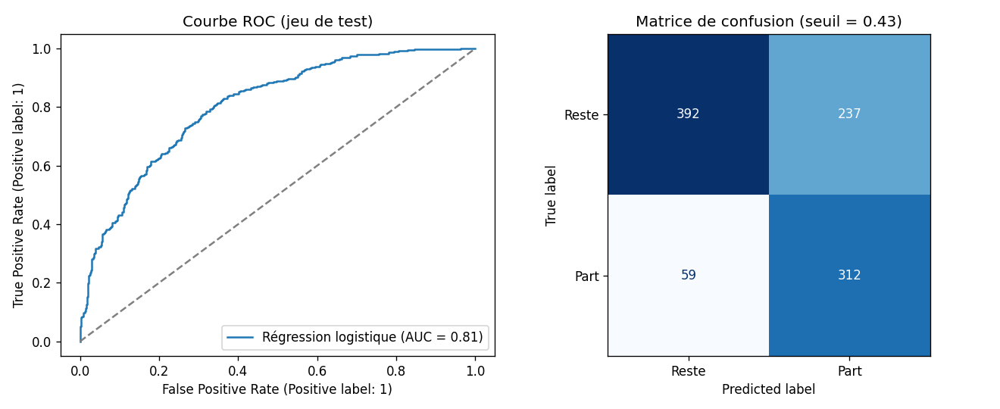

# 📉 Analyse et prédiction du churn clients – Opérateur télécom

[](https://github.com/Khadija-ibisk/customer-churn-analysis/actions/workflows/ci.yml)


Projet data **de bout en bout** : génération de données, nettoyage, requêtes SQL,
analyse exploratoire, machine learning, rapport automatique, tests et intégration continue.

**Question métier :** _quels clients risquent de résilier leur abonnement, pourquoi, et combien cela coûte-t-il ?_

---

## 🎯 Objectifs

1. Mesurer le taux de churn et le revenu mensuel perdu.
2. Identifier les facteurs qui expliquent le départ des clients.
3. Construire un modèle qui attribue un **score de risque** à chaque client.
4. Formuler des **recommandations** actionnables pour l'équipe rétention.

## 🧱 Architecture du pipeline

```
 Génération ──► Nettoyage ──► SQLite + SQL ──► EDA (graphiques) ──► Modélisation ──► Rapport
 (données        (doublons,     (KPI, CTE,        (matplotlib)        (3 modèles,       (reports/
  brutes)         NA, outliers)  fenêtrage)                             CV, seuil F1)     rapport.md)
```

| Étape | Module | Ce qui est fait |
|---|---|---|
| 1. Données | `src/churn/data_generation.py` | 5 000 clients synthétiques réalistes, avec défauts de qualité injectés |
| 2. Nettoyage | `src/churn/preprocessing.py` | Doublons, casse incohérente, valeurs manquantes, outliers (IQR), nouvelles variables |
| 3. SQL | `sql/kpis.sql`, `src/churn/sql_analysis.py` | Chargement SQLite, KPI par contrat / ancienneté / paiement, classement des régions (`RANK() OVER`) |
| 4. EDA | `src/churn/eda.py` | 6 graphiques : distribution, taux de churn par segment, corrélations |
| 5. Modèle | `src/churn/model.py` | Régression logistique vs Random Forest vs Gradient Boosting (validation croisée 5 plis), seuil optimisé F1 |
| 6. Rapport | `src/churn/pipeline.py` | `reports/rapport.md` + `reports/metrics.json` générés automatiquement |

## 📊 Résultats

Le rapport complet (tableaux KPI, graphiques, métriques) est régénéré à chaque push par la CI :
👉 **[reports/rapport.md](reports/rapport.md)**

| Taux de churn par contrat | Évaluation du modèle |
|---|---|
|  |  |

**Principaux enseignements**

- Le **contrat mensuel** est le premier facteur de départ ; les contrats biannuels sont très fidèles.
- Le risque est maximal pendant les **12 premiers mois** d'abonnement.
- Les **appels répétés au support** et le **paiement par chèque** augmentent fortement le risque.
- Le modèle retenu atteint un ROC AUC d'environ 0,8 (voir `reports/metrics.json`).

## 🚀 Lancer le projet

```bash
git clone https://github.com/Khadija-ibisk/customer-churn-analysis.git
cd customer-churn-analysis
python -m venv .venv
# Windows : .venv\Scripts\activate   |   macOS/Linux : source .venv/bin/activate
pip install -r requirements.txt

python run_pipeline.py   # exécute tout le pipeline (≈ 30 s)
pytest -v                # lance les tests
```

Utiliser le modèle entraîné sur de nouveaux clients :

```python
import pandas as pd
from churn import model, preprocessing

clients = preprocessing.clean(pd.read_csv("data/raw/customers_raw.csv"))
scores = model.predict(clients)          # proba_churn + a_risque
print(scores.head(10))                   # les 10 clients les plus à risque
```

## 📁 Structure

```
customer-churn-analysis/
├── .github/workflows/ci.yml   # tests + pipeline + publication du rapport
├── data/                      # raw/ et processed/ (générés, non versionnés)
├── models/                    # modèle entraîné (généré)
├── reports/                   # rapport.md, metrics.json, figures/
├── sql/kpis.sql               # requêtes d'analyse
├── src/churn/                 # code source du pipeline
├── tests/                     # tests unitaires (pytest)
├── run_pipeline.py            # point d'entrée
└── requirements.txt
```

## 🛠️ Compétences mises en œuvre

`Python` · `pandas` · `NumPy` · `SQL (SQLite, CTE, fonctions de fenêtrage)` · `matplotlib` ·
`scikit-learn (Pipeline, ColumnTransformer, validation croisée)` · `tests unitaires (pytest)` ·
`CI/CD (GitHub Actions)` · `qualité des données` · `restitution métier`

## 📝 Note sur les données

Les données sont **synthétiques** (générées avec une graine fixe pour être reproductibles) :
elles imitent la structure d'un jeu de churn télécom réel sans contenir aucune donnée personnelle.

## 📄 Licence

MIT – voir [LICENSE](LICENSE).
