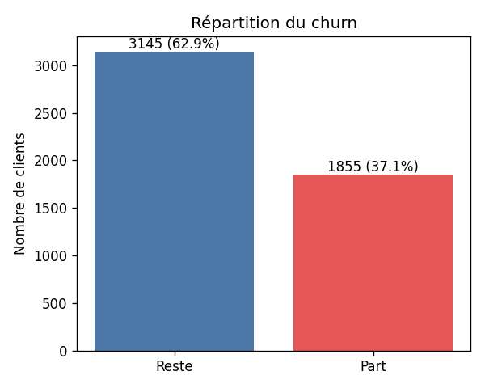
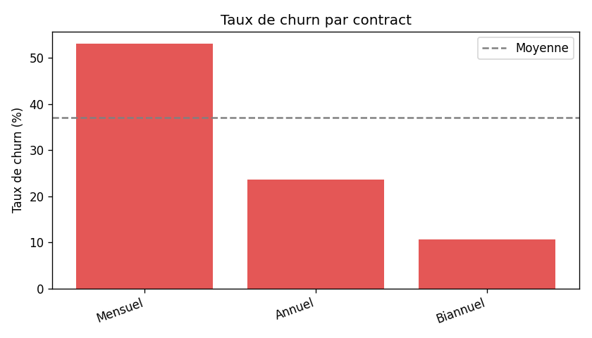
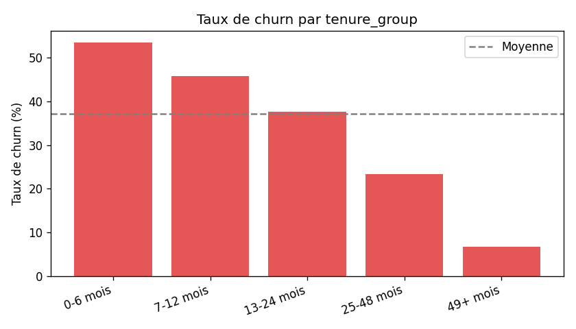
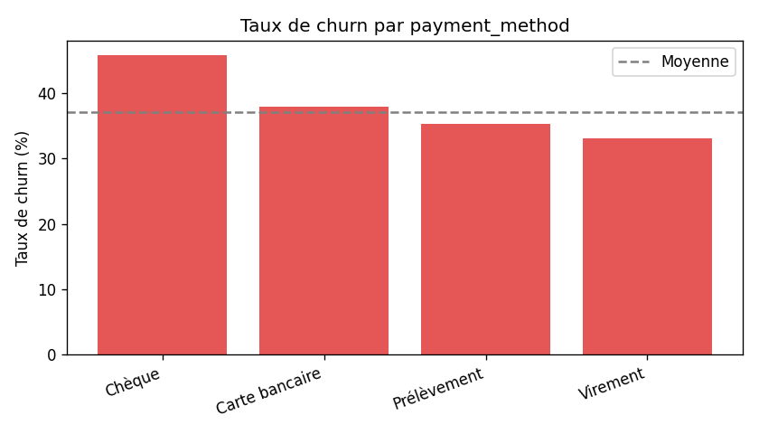
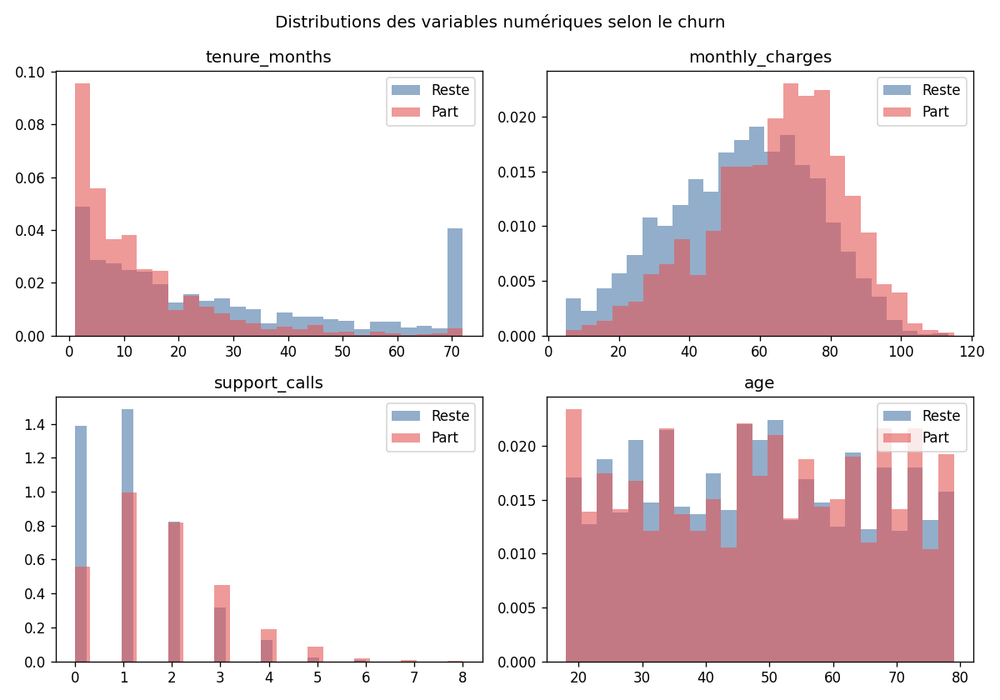
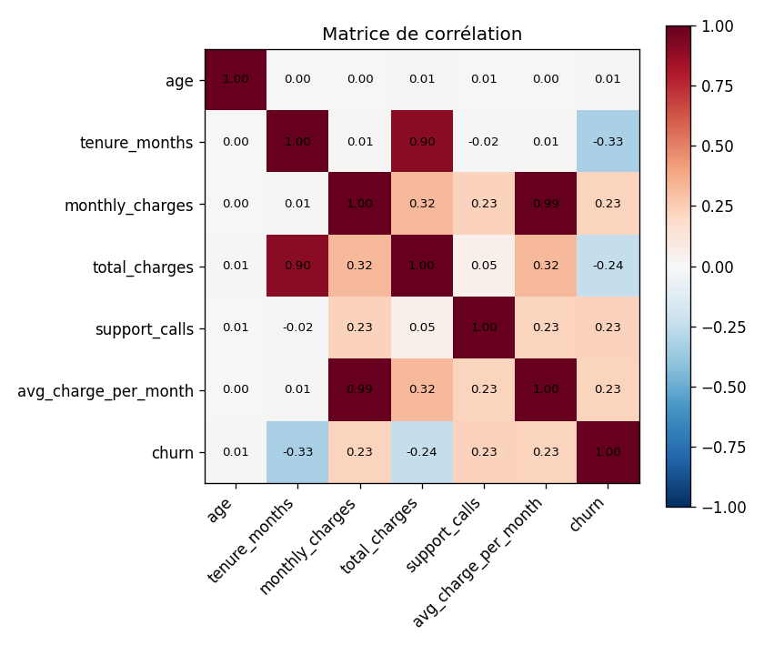
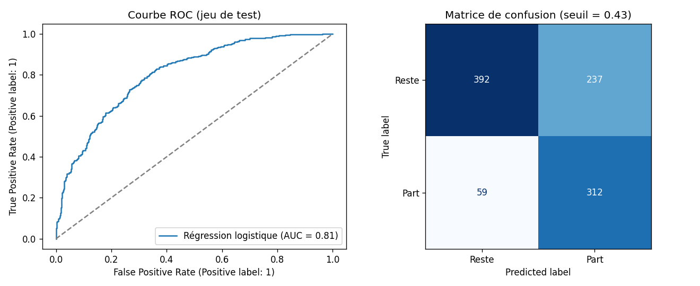
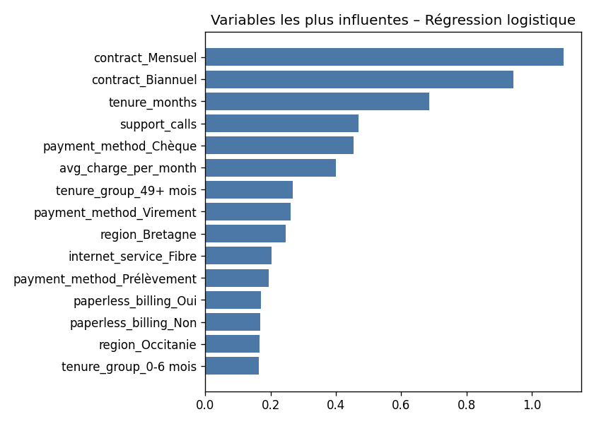

# Rapport d'analyse – Churn clients télécom

_Rapport généré automatiquement par `python run_pipeline.py`._

## 1. Synthèse

- **5000 clients** analysés, taux de churn de **37.1 %**.
- Revenu mensuel perdu à cause du churn : **119,922 €**.
- Meilleur modèle : **Régression logistique** – ROC AUC = **0.8058**, rappel = **84%** (part des clients partants détectés).

## 2. Qualité des données

| lignes_brutes | lignes_nettoyees | doublons_supprimes | total_charges_manquants | age_manquants | valeurs_manquantes_restantes |
| --- | --- | --- | --- | --- | --- |
| 5050 | 5000 | 50 | 100 | 75 | 0 |

## 3. Indicateurs clés (requêtes SQL)

### global_kpis

| nb_clients | taux_churn_pct | panier_mensuel_moyen | revenu_mensuel_perdu |
| --- | --- | --- | --- |
| 5000 | 37.10 | 58.59 | 119921.67 |

### churn_by_contract

| contract | nb_clients | taux_churn_pct | anciennete_moyenne |
| --- | --- | --- | --- |
| Mensuel | 2721 | 53.03 | 13.40 |
| Annuel | 1307 | 23.64 | 26.80 |
| Biannuel | 972 | 10.60 | 35.70 |

### churn_by_tenure_group

| tenure_group | nb_clients | taux_churn_pct |
| --- | --- | --- |
| 0-6 mois | 1489 | 53.53 |
| 7-12 mois | 859 | 45.87 |
| 13-24 mois | 1104 | 37.59 |
| 25-48 mois | 873 | 23.37 |
| 49+ mois | 675 | 6.67 |

### churn_by_payment

| payment_method | nb_clients | taux_churn_pct |
| --- | --- | --- |
| Chèque | 715 | 45.73 |
| Carte bancaire | 1498 | 37.92 |
| Prélèvement | 1744 | 35.26 |
| Virement | 1043 | 33.08 |

### top_risk_regions

| region | nb_clients | taux_churn_pct | revenu_mensuel_perdu | rang_impact |
| --- | --- | --- | --- | --- |
| Île-de-France | 1502 | 36.75 | 35377.41 | 1 |
| Auvergne-Rhône-Alpes | 968 | 37.71 | 23633.50 | 2 |
| Occitanie | 790 | 38.86 | 19627.44 | 3 |
| Hauts-de-France | 770 | 36.23 | 18236.35 | 4 |
| Grand Est | 478 | 38.91 | 12216.71 | 5 |
| Bretagne | 492 | 33.74 | 10830.26 | 6 |

## 4. Analyse exploratoire

## 5. Modélisation

Comparaison des modèles (validation croisée 5 plis, ROC AUC) :

| modele | roc_auc_moyen | roc_auc_std |
| --- | --- | --- |
| Régression logistique | 0.8141 | 0.0100 |
| Gradient Boosting | 0.8027 | 0.0091 |
| Random Forest | 0.8026 | 0.0081 |

Performance du modèle retenu sur le jeu de test :

| modele | seuil | roc_auc | accuracy | precision | recall | f1 | taille_test |
| --- | --- | --- | --- | --- | --- | --- | --- |
| Régression logistique | 0.4300 | 0.8058 | 0.7040 | 0.5683 | 0.8410 | 0.6783 | 1000 |

## 6. Recommandations métier

1. **Inciter au passage en contrat annuel/biannuel** : le contrat mensuel est le premier facteur de churn.
2. **Soigner les 12 premiers mois** : programme d'accueil et suivi proactif des nouveaux clients.
3. **Traiter les appels au support répétés** : au-delà de 3 appels, déclencher une action de rétention.
4. **Encourager le prélèvement automatique** : les payeurs par chèque partent nettement plus.
5. **Cibler les campagnes** avec le score du modèle (`models/churn_model.joblib`).
